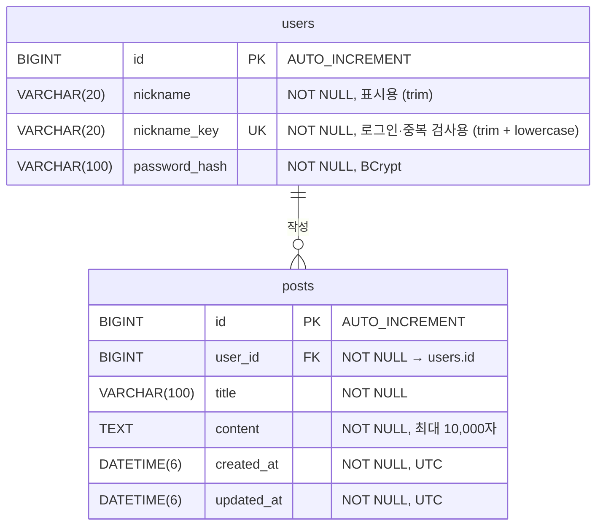

# ERD

기준: [프론트엔드 API 명세](../board-frontend/API.md), DB: MySQL

## users

| 컬럼 | 타입 | 제약 | 비고 |
|---|---|---|---|
| id | BIGINT | PK, AUTO_INCREMENT | |
| nickname | VARCHAR(20) | NOT NULL | 응답에 내려가는 닉네임. 양끝 공백 제거 후 2~20자 |
| nickname_key | VARCHAR(20) | NOT NULL, UNIQUE | `nickname.trim().lowercase()`. 로그인 조회·중복(409) 검사에 사용 |
| password_hash | VARCHAR(100) | NOT NULL | BCrypt 해시(60자, `{bcrypt}` 접두사 포함 시 68자). 원문 비밀번호 8자~72바이트 |

## posts

| 컬럼 | 타입 | 제약 | 비고 |
|---|---|---|---|
| id | BIGINT | PK, AUTO_INCREMENT | |
| user_id | BIGINT | NOT NULL, FK → users.id | 작성자. 요청 body가 아니라 인증 정보에서 채움 |
| title | VARCHAR(100) | NOT NULL | 양끝 공백 제거 후 1~100자 |
| content | TEXT | NOT NULL | 1~10,000자 (utf8mb4 최대 40KB < TEXT 64KB) |
| created_at | DATETIME(6) | NOT NULL | 작성 시 서버에서 설정 |
| updated_at | DATETIME(6) | NOT NULL | 작성 시 created_at과 동일, 수정 시에만 갱신 |

## 인덱스

| 테이블 | 인덱스 | 용도 |
|---|---|---|
| users | UNIQUE (nickname_key) | 로그인, 닉네임 중복 검사 |
| posts | (created_at DESC, id DESC) | 전체 목록 정렬 |
| posts | (user_id, created_at DESC, id DESC) | 내 글 목록(`mine=true`). FK 인덱스 역할도 겸함 |

## 개발 시 주의

- 엔티티 `User`는 `@Table(name = "users")`로 매핑합니다. `user`는 MySQL 예약어입니다.
- `Post.author`는 `@ManyToOne(fetch = LAZY)` + `@JoinColumn(name = "user_id")`. 목록 응답에 `author.nickname`이 필요하므로 목록 조회는 fetch join(또는 `@EntityGraph`)으로 N+1을 피합니다.
- 회원 탈퇴는 범위 밖이라 FK는 기본값(삭제 제한)으로 둡니다.
- 키워드 검색(`title LIKE %kw% OR content LIKE %kw%`)은 인덱스를 타지 않습니다. 연습 규모에서는 충분하고, 데이터가 커지면 FULLTEXT 인덱스로 바꿉니다.
- 날짜는 Kotlin `Instant`로 매핑하면 `hibernate.jdbc.time_zone: UTC` 설정과 맞물려 UTC로 저장됩니다.
